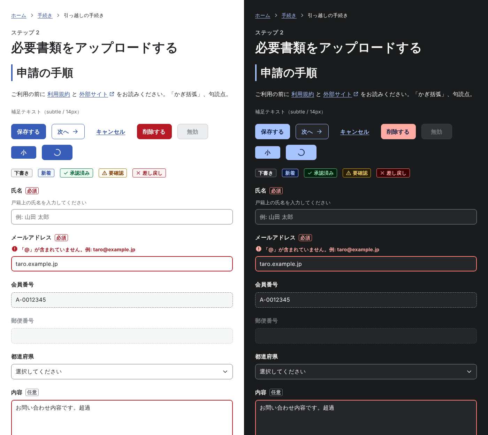

# tkc310-ui

プロジェクトで使い回す、自分用のデザインシステムです。
[デジタル庁デザインシステム（DADS）](https://design.digital.go.jp/dads/) のアクセシビリティ基準と構造を土台に、
キーカラー「藍」・ダークテーマ・自己改善の仕組みを加えて再設計しています。
画面設計のルールは [design-principles](https://github.com/tkc310/agents-playground/tree/main/docs/design-principles) を採用しています。

リポジトリ名は `design-system-myself`、パッケージ名は `tkc310-ui`、CSS の接頭辞は `tkc-` です。



| 含まれるもの | 場所 |
| --- | --- |
| ルールブック（原則・アクセシビリティ・トークン・コンポーネント・文言・改善ループ） | [`docs/rulebook/`](./docs/rulebook/) |
| トークン（primitive / semantic、ライト / ダーク） | [`tokens/`](./tokens/) → `src/styles/tokens.css` |
| React コンポーネント 18 種 | [`src/components/`](./src/components/) |
| Storybook | `npm run dev` |
| AI エージェント向け仕様 | [`DESIGN.md`](./DESIGN.md)、[`AGENTS.md`](./AGENTS.md) |
| 自己改善の仕組み | [`docs/rulebook/06-improvement-loop.md`](./docs/rulebook/06-improvement-loop.md) |
| プロダクト用 DESIGN.md の雛形 | [`templates/PRODUCT-DESIGN.md`](./templates/PRODUCT-DESIGN.md) |

## はじめる

```bash
npm install
npm run dev        # Storybook を http://localhost:6006 で起動
npm run check      # 規約・コントラスト・型などをまとめて検査
npm test           # 単体テスト + 全ストーリーの a11y テスト
```

## 使う

```tsx
import { Button, FormField, TextField } from 'tkc310-ui';
import 'tkc310-ui/styles.css';

export function SignUp() {
  return (
    <form>
      <FormField label="メールアドレス" required supportText="例: taro@example.jp">
        <TextField type="email" autoComplete="email" />
      </FormField>
      <Button type="submit">登録する</Button>
    </form>
  );
}
```

テーマは `<html data-theme="dark">` で切り替えます。属性が無ければ OS の設定に従います。
React 以外の環境では `tokens.css` の CSS 変数と `tkc-` クラスの規約だけを使うこともできます。

## コンポーネント

Accordion / Breadcrumb / Button / Card / Checkbox / Divider / FormField / Heading / Icon / Link /
NotificationBanner / RadioGroup・Radio / Select / Stack / Tag / Text / TextField / Textarea

## トークンを変える

```bash
# 例: キーカラーの色相を変える
#   tokens/palette.config.json の families.indigo.hue を編集
npm run tokens:palette   # primitive を再生成
npm run tokens:build     # CSS / TS / DESIGN.md を再生成
npm run check:contrast   # 全組み合わせのコントラストを両テーマで検証
```

## ライセンス

MIT
