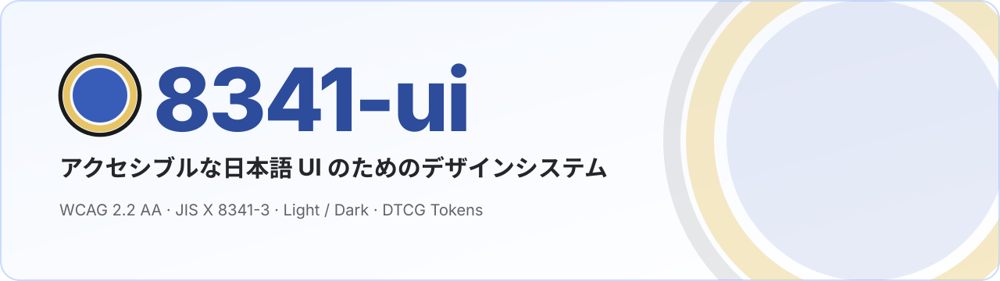

<p align="center">
  <picture>
    <source media="(prefers-color-scheme: dark)" srcset="./docs/assets/banner-dark.svg">
    
  </picture>
</p>

<p align="center">
  <b>アクセシビリティを土台に、AI エージェントと一緒に育てるデザインシステム。</b><br>
  WCAG 2.2 AA を全トークン・全コンポーネントで検証し、shadcn のレジストリでそのまま取り込めます。
</p>

<p align="center">
  <a href="https://tkc310.github.io/8341-ui/"><b>Storybook</b></a> ·
  <a href="https://tkc310.github.io/8341-ui/r/registry.json"><b>Registry</b></a> ·
  <a href="./DESIGN.md"><b>DESIGN.md</b></a> ·
  <a href="./docs/rulebook/"><b>ルールブック</b></a> ·
  <a href="https://github.com/tkc310/8341-ui/releases"><b>Releases</b></a> ·
  <a href="./CONTRIBUTING.md"><b>開発ガイド</b></a>
</p>

<p align="center">
  <a href="https://github.com/tkc310/8341-ui/actions/workflows/ci.yml"></a>
  <a href="https://github.com/tkc310/8341-ui/releases"></a>
  <a href="./LICENSE"></a>
  <a href="./docs/rulebook/02-accessibility.md"></a>
  <a href="https://tkc310.github.io/8341-ui/"></a>
  <a href="https://tkc310.github.io/8341-ui/r/registry.json"></a>
  <a href="./docs/ai-agents.md"></a>
</p>

<br>

## 特長

- **アクセシビリティが前提** — [デジタル庁デザインシステム（DADS）](https://design.digital.go.jp/dads/)の基準を土台に、WCAG 2.2 AA と JIS X 8341-3 を最低ラインにしています。文字は 4.5:1、境界は 3:1 で、トークンの全組み合わせをライトとダークの両方で CI が検証します。タップ領域は 44px、フォーカスは明暗の二重線です。
- **藍のキーカラーと共通明度カーブ** — OKLCH で 8 系統 × 13 段階のパレットを生成します。どの色相でも同じ段階番号ならコントラストがそろうので、色を替えても検証が崩れません。
- **コードを持てる配布** — shadcn のレジストリで、部品をプロジェクトにコピーして使います。トークン入りのテーマも同梱しているので、npm のパッケージは要りません。版を固定した取り込みもできます。
- **デザイントークンが正本** — W3C DTCG 2025.10 → Style Dictionary v5 で、CSS 変数・Tailwind v4 の `@theme`・Figma Variables を一度に生成します。
- **AI エージェント向けの仕様とスキル** — `DESIGN.md` と画面設計のルール（[design-principles](./docs/design-principles/README.md)）を、Claude Code・Cursor・Codex が同じスキルとして読みます。
- **自己改善の仕組み** — 週次の健康診断、改善のバックログとログ、再発防止のチェックの追加までを、[改善ループ](./docs/rulebook/06-improvement-loop.md)として回します。

<!-- factory:start -->
## デザインシステムファクトリー

8341-ui はそのまま使えるデザインシステムであり、**新しいデザインシステムを作るひな形**でもあります。
`/ds-factory` を呼ぶと、エージェントが design-principles に沿ってヒアリングします。そのうえで名前・接頭辞・キーカラー・リポジトリを置き換えた新しいリポジトリを生成し、トークンの再生成と検査まで仕上げます。

```text
docs/design-principles ─┬─▶ 8341-ui（このリポジトリ）
ヒアリング ─▶ ds-factory ┴─▶ あなたのデザインシステム（別リポジトリ）
```

詳しくは [docs/factory.md](./docs/factory.md) を読んでください。

<!-- factory:end -->
## クイックスタート

**1. レジストリを登録する** — 利用側の `components.json` に追加します。

```json
{
  "registries": { "@8341": "https://tkc310.github.io/8341-ui/r/{name}.json" }
}
```

版を固定するときは、URL を `https://tkc310.github.io/8341-ui/r/v0.1.0/{name}.json` のようにします。

**2. 部品を取り込む**

```bash
npx shadcn@latest add @8341/8341-base @8341/button @8341/form-field @8341/text-field
```

**3. テーマを読み込む**

```css
/* globals.css */
@import 'tailwindcss';
@import './styles/8341-ui.css';
```

あとは使うだけです。テーマは `<html class="dark">` か `<html data-theme="dark">` でダークに切り替わり、どちらも無ければ OS の設定に従います。
テーマ（`styles/8341-ui.css`）はトークンを同梱しています。トークンが更新されたら `npx shadcn@latest add @8341/theme --overwrite` で取り込み直します。

```tsx
import { Button } from '@/components/ui/button';
import { FormField } from '@/components/ui/form-field';
import { TextField } from '@/components/ui/text-field';

export function SignUp() {
  return (
    <form>
      <FormField label="メールアドレス" required supportText="例: taro@example.jp">
        <TextField type="email" autoComplete="email" />
      </FormField>
      <Button type="submit">登録する</Button>
    </form>
  );
}
```

<details>
<summary>npm パッケージとして使う（公開した場合）</summary>

npm への公開は既定で無効です（[リリース](./docs/releasing.md)）。公開した版は、次のように使えます。

```tsx
import { Button } from '8341-ui/button';
```

```css
/* Tailwind を使う場合。@source はこの CSS から見た node_modules/8341-ui/dist への相対パス */
@import 'tailwindcss';
@import '8341-ui/theme.css';
@source "../node_modules/8341-ui/dist";
```

Tailwind を使わない場合は、ビルド済みの `import '8341-ui/styles.css'` を読み込みます。

</details>

## コンポーネント

ヘッドレス UI の [Base UI](https://base-ui.com/) に、トークンの見た目を載せた 18 種類です。使い分けの規約は [04 コンポーネント](./docs/rulebook/04-components.md)、動く見本は [Storybook](https://tkc310.github.io/8341-ui/) にあります。

| 種類 | コンポーネント |
| --- | --- |
| 操作 | `Button` · `Link` |
| フォーム | `FormField` · `TextField` · `Textarea` · `Select` · `Checkbox` · `RadioGroup` |
| 表示 | `Heading` · `Text` · `Tag` · `Icon` · `Card` · `Divider` · `Stack` |
| ナビゲーション | `Breadcrumb` · `Accordion` |
| フィードバック | `NotificationBanner` |

## 技術スタック

| 領域 | 採用 |
| --- | --- |
| UI | React 19 · [Base UI](https://base-ui.com/) v1 · [Tailwind CSS](https://tailwindcss.com/) v4 · [tailwind-variants](https://www.tailwind-variants.org/) v3 |
| トークン | [W3C DTCG](https://www.designtokens.org/) 2025.10 · [Style Dictionary](https://styledictionary.com/) v5 · Figma Variables / Code Connect |
| 配布 | [shadcn](https://ui.shadcn.com/) レジストリ（`registry:base` で Base UI を固定）· npm（任意） |
| ツールチェーン | [Vite+](https://github.com/voidzero-dev/vite-plus)（oxlint · oxfmt · Vitest 5 · tsdown）· TypeScript 7 · Node.js 24 LTS · pnpm 12 |
| 品質 | Storybook 10 · addon-a11y（axe）· Playwright · dependency-cruiser · Changesets |

選んだ理由は [ADR-0008](./docs/decisions/0008-stack-2026-10.md) と [ADR-0015](./docs/decisions/0015-dependency-update-2026-10.md) にあります。

## 開発

道具の版は [`.tool-versions`](./.tool-versions) にあり、コマンドはすべて `make` で実行します（`make` だけで一覧が出ます）。

```bash
make setup    # 道具（mise / asdf）と依存を入れる
make dev      # Storybook を起動する（http://localhost:6006）
make verify   # fmt・lint・型・コントラスト・生成物の鮮度・テスト
```

トークンを変えたら `make generate` で生成物を更新します。見た目が変わる PR には、`make storybook-preview` で公開したプレビューを添えます。
詳しい手順は [CONTRIBUTING.md](./CONTRIBUTING.md) を読んでください。

<details>
<summary>リポジトリの構成</summary>

```text
packages/tokens/          トークン（8341-ui-tokens）: DTCG → CSS 変数・Tailwind テーマ・Figma JSON
packages/ui/              コンポーネント（8341-ui）・shadcn レジストリ
apps/storybook/           Storybook 10・e2e・レジストリの配信元
docs/design-principles/   画面設計のルール（UI の方向性 → 特化ルール → 原則 → WCAG）
docs/rulebook/            ルールブック（原則・アクセシビリティ・トークン・コンポーネント・文言・改善ループ）
docs/decisions/           設計判断の記録（ADR）
.claude/skills/           AI エージェントのスキル（.agents/skills から共有）
templates/                プロダクト用 DESIGN.md の雛形
```

</details>

## ドキュメント

| 読みたいこと | 文書 |
| --- | --- |
| AI エージェント向けの仕様（トークン・コンポーネント・Do / Don't） | [DESIGN.md](./DESIGN.md) · [AGENTS.md](./AGENTS.md) |
| 画面設計のルール | [docs/design-principles](./docs/design-principles/README.md) |
| ルールブック | [docs/rulebook](./docs/rulebook/) |
| 開発・運用・リリース | [CONTRIBUTING.md](./CONTRIBUTING.md) · [docs/operations.md](./docs/operations.md) · [docs/releasing.md](./docs/releasing.md) |
| AI エージェントへの対応 | [docs/ai-agents.md](./docs/ai-agents.md) |
| 設計判断の記録 | [docs/decisions](./docs/decisions/) |
| ロゴとバナー | [docs/assets](./docs/assets/README.md) |
| 脆弱性の報告 | [SECURITY.md](./SECURITY.md) |

## ライセンス

[MIT](./LICENSE) © Takashi Sato
